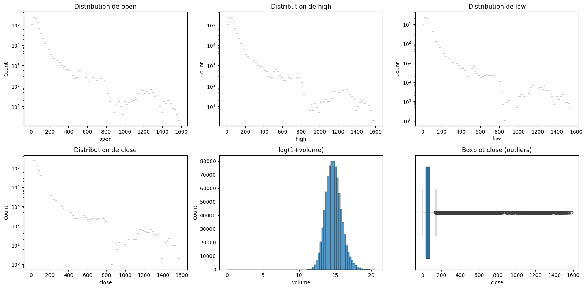
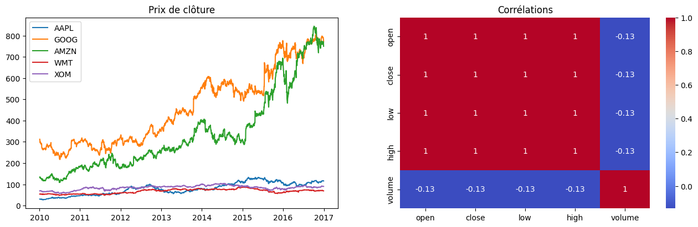
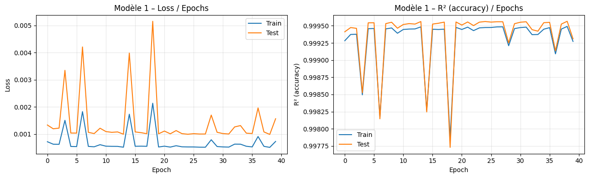
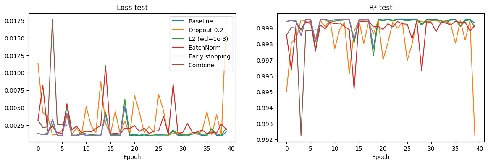
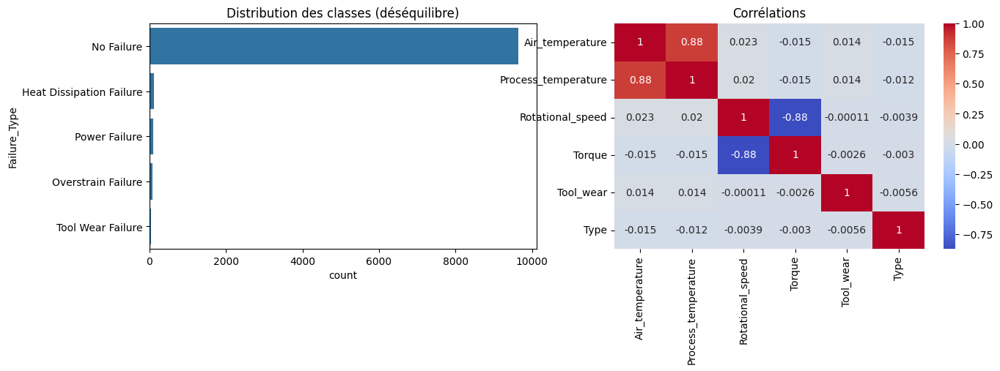
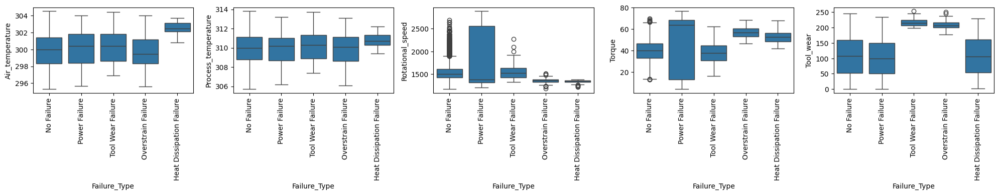
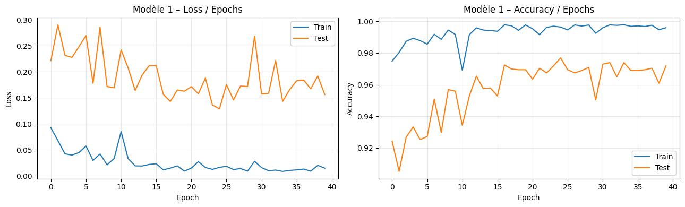
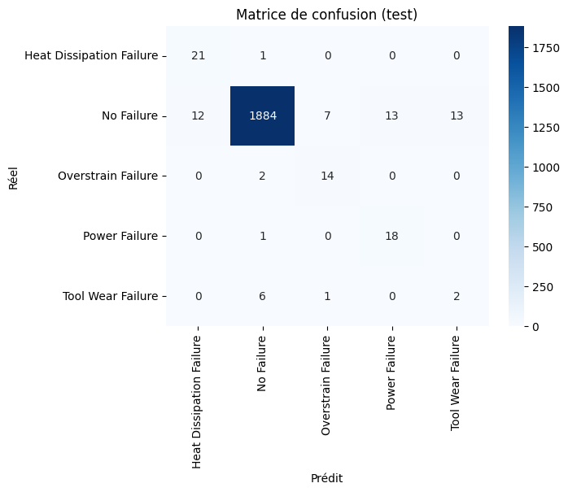
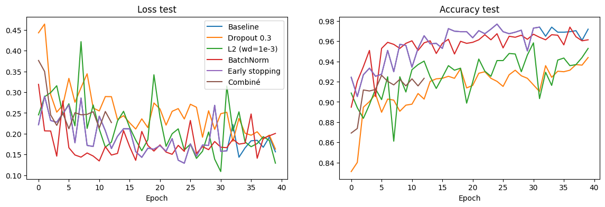

# Lab 1 – Deep Learning : MLP avec PyTorch
**Université Abdelmalek Essaadi – FST Tanger – Master MBD – Pr. L. Elaachak**
Étudiante : _[Nom Prénom]_

## Contenu du dépôt
| Fichier | Description |
|---|---|
| `Lab1_Part1_Regression_NYSE.ipynb` | Partie 1 : régression (NYSE) |
| `Lab1_Part2_Classification_Maintenance.ipynb` | Partie 2 : classification multi-classes (Predictive Maintenance) |
| `images/` | Figures utilisées dans ce rapport |

Environnement : Kaggle Notebook (CPU), PyTorch, scikit-learn, imbalanced-learn. Les datasets sont téléchargés via `kagglehub`.
Les modèles MLP PyTorch sont encapsulés dans des classes compatibles scikit-learn (`fit`/`predict`/`score`) afin d'utiliser `GridSearchCV`.

---
## Partie 1 – Régression (NYSE, `prices-split-adjusted.csv`)
**Objectif** : prédire le prix de clôture du jour suivant (`close(t+1)`) à partir de open, high, low, close et log(volume) du jour *t*.

### 1. EDA
851 264 lignes, 501 actions, 2010–2016, aucune valeur manquante ni doublon. Prix très asymétriques (moyenne 65 $, médiane 48 $, max 1 578 $), volume extrêmement asymétrique (transformation `log1p`), forte corrélation entre open/high/low/close.

### 2. Préparation
Cible = close du lendemain par action. **Split temporel** : train < 2016 (725 139 lignes), test = 2016 (125 624 lignes). Standardisation (X et y) ajustée sur le train.

### 3. Modèle et GridSearch
MLP (Linear + ReLU), perte MSE, métrique « accuracy » = R². `GridSearchCV` (3 plis, 36 combinaisons, 108 entraînements, sous-échantillon de 30 000 lignes) sur : learning rate {1e-3, 1e-2}, optimiseur {adam, rmsprop, sgd}, architecture {(32), (64,32), (128,64,32)}, epochs {10, 20}.
**Meilleurs paramètres** : RMSprop, lr = 1e-3, une couche de 32 neurones (R² CV = 0,99943).

### 4. Courbes Loss / R² (modèle 1)

R² train = 0,9993, R² test = 0,9993, RMSE test ≈ 2,71 $, MAE test ≈ 1,18 $.
**Interprétation** : pas de sur-apprentissage (train ≈ test) ; quelques pics d'instabilité dus à RMSprop avec learning rate constant. La tâche est presque triviale (le prix de demain ≈ celui d'aujourd'hui), le R² élevé doit donc être relativisé.

### 5. Régularisation

| Modèle | R² test | RMSE test ($) | MAE test ($) |
|---|---|---|---|
| Baseline | 0,9993 | 2,71 | 1,18 |
| Dropout 0,2 | 0,9923 | 9,09 | 3,33 |
| L2 (wd=1e-3) | 0,9991 | 3,16 | 1,38 |
| BatchNorm | 0,9992 | 2,99 | 1,60 |
| **Early stopping** | **0,9996** | **2,16** | **0,96** |
| Combiné | 0,9990 | 3,21 | 1,86 |

Le modèle de base ne sur-apprend pas, donc la régularisation n'apporte presque rien et peut dégrader (Dropout surtout). **Early stopping** est la seule technique qui améliore le résultat, en conservant les poids de la meilleure epoch malgré les pics d'instabilité.

---
## Partie 2 – Classification multi-classes (Predictive Maintenance)
**Objectif** : prédire le type de panne (`Failure Type`) à partir des capteurs.

### 1. Pré-traitement
- Aucune valeur manquante ni doublon ; noms de colonnes nettoyés.
- Suppression de 27 lignes incohérentes (dont les 18 « Random Failures ») → 9 973 lignes, 5 classes.
- Suppression de `UDI`, `Product_ID` et `Target` (fuite de la cible) ; `Type` encodé en ordinal (L=0, M=1, H=2).
- Split stratifié 80/20 (7 978 train / 1 995 test), puis standardisation (`StandardScaler`) ajustée sur le train.
- Outliers (IQR) : 418 sur la vitesse de rotation, 70 sur le couple ; conservés car liés aux pannes.

### 2. EDA

Fort déséquilibre : No Failure ≈ 96,7 %, pannes de 45 à 112 exemples. Les boxplots montrent des signatures par panne (Heat Dissipation : température de l'air élevée et vitesse basse ; Overstrain : couple et usure élevés ; Power Failure : forte dispersion du couple et de la vitesse ; Tool Wear : usure autour de 200-250 min mais chevauchement avec d'autres classes).

### 3. Augmentation / équilibrage : SMOTE (train uniquement)
Avant : No Failure 7 714, Heat 90, Power 76, Overstrain 62, Tool Wear 36 → Après : **7 714 par classe**.

### 4. Modèle et GridSearch
MLP, perte CrossEntropy. `GridSearchCV` sur un `Pipeline` imblearn (SMOTE à l'intérieur de chaque pli → pas de fuite), score **F1 macro**, 3 plis stratifiés, 24 combinaisons (72 entraînements) : learning rate {1e-3, 1e-2}, optimiseur {adam, rmsprop}, architecture {(32,16), (64,32), (128,64,32)}, epochs {20, 40}.
**Meilleurs paramètres** : Adam, lr = 0,01, couches 128-64-32, 40 epochs (F1 macro CV = 0,687).

### 5. Courbes Loss / Accuracy

La loss train tombe à ≈ 0,01 alors que la loss test reste entre 0,13 et 0,29 en oscillant : **sur-apprentissage**. La courbe train est calculée sur données SMOTE (équilibrées), la courbe test sur données réelles (déséquilibrées), donc les accuracies ne sont pas directement comparables.

### 6. Métriques du modèle 1
| Jeu | Accuracy | Précision (macro) | Sensibilité (macro) | Spécificité (macro) | F1 macro | F1 pondéré |
|---|---|---|---|---|---|---|
| Train | 0,9882 | 0,7895 | 0,9920 | 0,9969 | 0,8740 | 0,9891 |
| Test | 0,9719 | 0,5963 | 0,7952 | 0,9650 | 0,6746 | 0,9749 |

Les pannes sont bien détectées (rappel 0,88 à 0,95) mais avec des fausses alarmes (précision ≈ 0,6) ; **Tool Wear Failure** reste mal prédite (F1 = 0,17) : seulement 36 exemples d'entraînement, et leurs valeurs chevauchent d'autres classes.

### 7. Régularisation

| Modèle | Accuracy | Précision | Sensibilité | Spécificité | F1 macro |
|---|---|---|---|---|---|
| Baseline | 0,9719 | 0,5963 | 0,7952 | 0,9650 | 0,6746 |
| Dropout 0,3 | 0,9439 | 0,5351 | 0,8577 | 0,9711 | 0,6270 |
| L2 (wd=1e-3) | 0,9529 | 0,5722 | 0,8319 | 0,9641 | 0,6522 |
| BatchNorm | 0,9614 | 0,5750 | 0,7783 | 0,9571 | 0,6468 |
| **Early stopping** | **0,9769** | **0,6906** | 0,7831 | 0,9602 | **0,7251** |
| Combiné | 0,9263 | 0,5221 | **0,8769** | 0,9705 | 0,6138 |

**Early stopping** donne le meilleur compromis (F1 macro 0,725 contre 0,675). Dropout, L2 et la combinaison augmentent la sensibilité au prix de la précision et de l'accuracy. Limites : très peu d'exemples de Tool Wear ; résultats sensibles à la graine aléatoire.

---
## Synthèse personnelle
Ce TP m'a permis de maîtriser le cycle complet d'un projet de deep learning tabulaire avec PyTorch : EDA, prétraitement sans fuite de données (split avant standardisation et SMOTE, suppression de `Target`), construction de MLP, recherche d'hyperparamètres avec `GridSearchCV` via un wrapper scikit-learn, courbes d'apprentissage, métriques adaptées au déséquilibre et régularisation (Dropout, L2, BatchNorm, early stopping).
Points clés : (1) un R² ou une accuracy élevés peuvent être trompeurs, il faut les comparer à une baseline et utiliser F1/sensibilité sur des données déséquilibrées ; (2) la régularisation n'est utile que s'il y a sur-apprentissage (partie 2) et peut dégrader un modèle qui n'en a pas besoin (partie 1) ; (3) l'early stopping a été la technique la plus efficace dans les deux parties.
